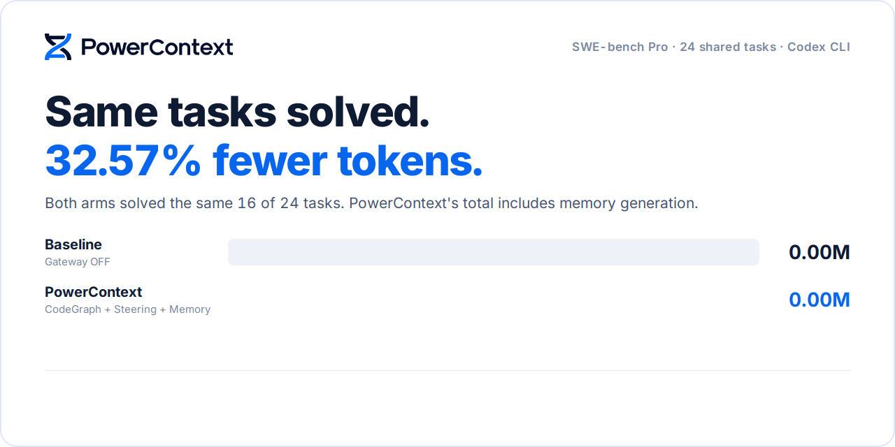

<p align="center">
  <picture>
    <source media="(prefers-color-scheme: dark)" srcset="docs/assets/readme-hero-en-dark.gif" />
    
  </picture>
</p>

<p align="center">
  <a href="#quick-start"><b>Get started</b></a> &nbsp; · &nbsp;
  <a href="#proof-it-works">See the proof</a> &nbsp; · &nbsp;
  <a href="https://powercontext.oceanbase.io/en/docs/">Documentation</a> &nbsp; · &nbsp;
  <a href="https://discord.com/invite/74cF8vbNEs">Discord</a>
</p>
<p align="center">
  <a href="README.md">English</a> · <a href="README_CN.md">中文</a> &nbsp; / &nbsp;
  <a href="https://pypi.org/project/powercontext/">Python package</a> · <a href="LICENSE">Apache 2.0</a>
</p>

## Why PowerContext?

**Your agent's tokens should move the task forward.** Less repeated searching, fewer unproductive round trips, and project knowledge that is still useful when the next session starts.

- **Focus on the task.** Bring relevant code and clear working guidance into the agent's path to a fix.
- **Keep your agent.** Connect Codex, Claude Code, and other supported hosts, or integrate with your own application.
- **Keep what you learn.** Retain decisions, constraints, and handoffs across sessions, agents, and teammates.

## What is PowerContext?

**PowerContext is an open-source context service for AI agents that keeps work moving across sessions, agents, and teams.** It stores decisions, constraints, evidence, and progress outside a single conversation, so the next session or teammate can pick up from the current state.

- **Memory and handoffs:** retain useful information, task progress, and next steps.
- **Experience and skills:** turn proven approaches into reusable lessons and procedures, reviewed before reuse.
- **Traceable context:** isolate projects in Scopes, preserve revisions and provenance, and retrieve context for the task at hand.

Run it as a service through HTTP, MCP, Python, or Agent integrations, or embed Core in your own application. [Explore the product and workflows →](https://powercontext.oceanbase.io/en/docs/workflows/memory-and-handoff/)

## Proof it works

**Spend fewer tokens. Lower model costs.** On the same 24 SWE-bench Pro tasks, PowerContext used **32.57% fewer tokens** and delivered **15.42% lower estimated model cost**, including memory generation. Both groups solved the **same 16 tasks**.

**Solving alone uses 40.30% fewer tokens; including memory generation overhead, the reduction is 32.57%.** Saved memories can be reused in later sessions, extending the value of accumulated knowledge. This benchmark measures the current run; future reuse benefits have not been measured here.

**Where the savings come from: re-sent context, not new input.** Every model call in an agent loop re-sends the accumulated context. In the baseline, 96% of input tokens were this re-sent context (cache hits). All of PowerContext's savings came from it: re-sent context fell by 10.75M tokens (−42.67%), while new input per call rose by 0.14M (+14.10%).

**Why not compress tool output?** Tool output is only part of an agent's token usage, so even aggressive compression has a ceiling. Compression can also drop details the model needs; the model then calls the tool again to fetch the original, saving no tokens and adding a round trip. This run compressed no tool output. Instead, the agent was guided to locate code before reading it, read only the lines it needs, batch independent work, and run focused tests, cutting detours at the source.

**Best task: 63.49% fewer tokens and 51.98% lower estimated model cost.** Both runs passed case 456, with tokens falling from 2.30 million to 0.84 million, including memory generation.

[Explore the full benchmark: task results, methodology, and setup →](docs/benchmarks/token-savings/README.md)

### Coding: put context to work

This benchmark runs in **gateway mode**, with code retrieval, working guidance, and project memory enabled together:


**Extract memory. Reuse the cache.** In gateway mode, PowerContext supports prefix-cached memory extraction, reusing context prefixes from solving requests to lower input costs on cache hits. Keep useful memories while reducing the overhead of creating them.

## Quick start

You need Python 3.11+, Git, and [uv](https://docs.astral.sh/uv/getting-started/installation/). This setup pins version 1.5.0 for macOS and Linux.

```bash
uv tool install --force "powercontext[cli,server]==1.5.0"
mkdir -p powercontext-config && cd powercontext-config
powercontext config init --language en --output .env
powercontext config validate --env-file .env
powercontext server run --env-file .env
```

Keep the service running. Follow **`.env.next-steps.md`** to create and bind your Scope. Start with Basic memory; automatic extraction requires Generation and Embedding credentials.

For Codex, install the matching integration in another terminal:

```bash
powercontext setup codex --ref powercontext-v1.5.0
powercontext doctor codex
```

Start a new session and trust the hooks when prompted. Save a project decision, then recall it in a later session. [Full setup guide →](https://powercontext.oceanbase.io/en/docs/get-started/quickstart/)

<sub>This starts the context service. It does not automatically reproduce the benchmark's Gateway, CodeGraph, or Steering configuration; see the evidence report.</sub>

## Fits your workflow

<!-- Add integrations using an original logo asset, a product name, and a documentation link. -->
<table width="100%">
  <tr>
    <td align="center" width="20%"><a href="https://powercontext.oceanbase.io/en/docs/integrations/codex/"><br />Codex</a></td>
    <td align="center" width="20%"><a href="https://powercontext.oceanbase.io/en/docs/integrations/claude-code/"><br />Claude Code</a></td>
    <td align="center" width="20%"><a href="https://github.com/oceanbase/powercontext/tree/master/integrations/minimax#readme"><br />MiniMax Code</a></td>
    <td align="center" width="20%"><a href="https://powercontext.oceanbase.io/en/docs/integrations/dsh/"><br />DeepSeek Harness</a></td>
    <td align="center" width="20%"><a href="https://powercontext.oceanbase.io/en/docs/integrations/zcode/"><br />ZCode</a></td>
  </tr>
  <tr>
    <td align="center" width="20%"><a href="https://powercontext.oceanbase.io/en/docs/integrations/kimi-code/"><br />Kimi Code</a></td>
    <td align="center" width="20%"><a href="https://github.com/oceanbase/powercontext/tree/master/integrations/hermes#readme"><br />Hermes Agent</a></td>
    <td align="center" width="20%"><a href="https://powercontext.oceanbase.io/en/docs/integrations/pi/"><br />Pi Coding Agent</a></td>
    <td align="center" width="20%"><a href="https://powercontext.oceanbase.io/en/docs/integrations/openclaw/"><br />OpenClaw</a></td>
    <td align="center" width="20%"><a href="https://powercontext.oceanbase.io/en/docs/integrations/opencode/"><br />OpenCode</a></td>
  </tr>
  <tr>
    <td align="center" width="20%"><a href="https://github.com/oceanbase/powercontext/tree/master/integrations/workbuddy#readme"><br />WorkBuddy</a></td>
    <td align="center" width="20%"><a href="https://github.com/oceanbase/powercontext/tree/master/integrations/bub#readme"><br />Bub</a></td>
    <td align="center" width="20%"><a href="https://powercontext.oceanbase.io/en/docs/integrations/pydantic-ai/"><br />Pydantic AI</a></td>
    <td align="center" width="20%"><a href="https://powercontext.oceanbase.io/en/docs/integrations/langchain/"><br />LangChain</a></td>
    <td align="center" width="20%"><a href="https://powercontext.oceanbase.io/en/docs/integrations/langgraph/"><br />LangGraph</a></td>
  </tr>
</table>

Codex is officially maintained; other Agent and Python framework integrations are community-maintained. Bub is for evaluation only. See the capability matrix for supported features.

[More integrations and capability comparison →](https://powercontext.oceanbase.io/en/docs/integrations/capabilities/)

**Apps & teams** — [Python / HTTP / MCP](https://powercontext.oceanbase.io/en/docs/develop/interfaces/) · [Memory & Handoff](https://powercontext.oceanbase.io/en/docs/workflows/memory-and-handoff/) · [Deployment & access](https://powercontext.oceanbase.io/en/docs/workflows/scopes-and-access/)

---

[Documentation](https://powercontext.oceanbase.io/en/docs/) · [Contribute](https://github.com/oceanbase/powercontext/blob/main/CONTRIBUTING.md) · [Issues](https://github.com/oceanbase/powercontext/issues) · [Discord](https://discord.com/invite/74cF8vbNEs)

PowerContext is the successor to [PowerMem](https://www.powermem.ai/). Released under [Apache 2.0](LICENSE).
