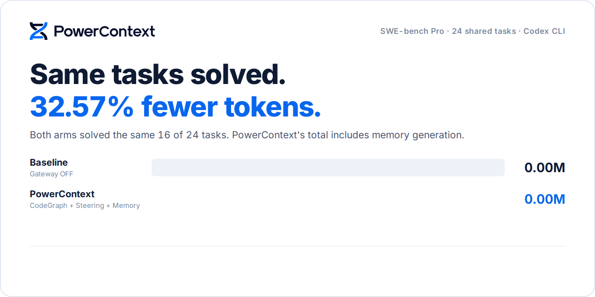
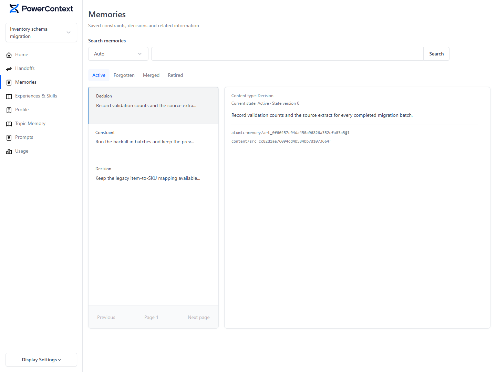
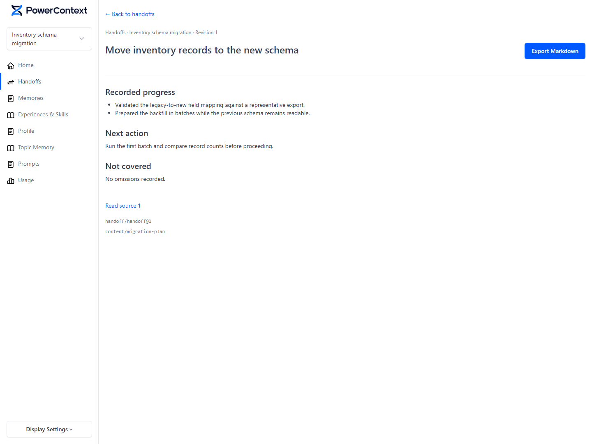
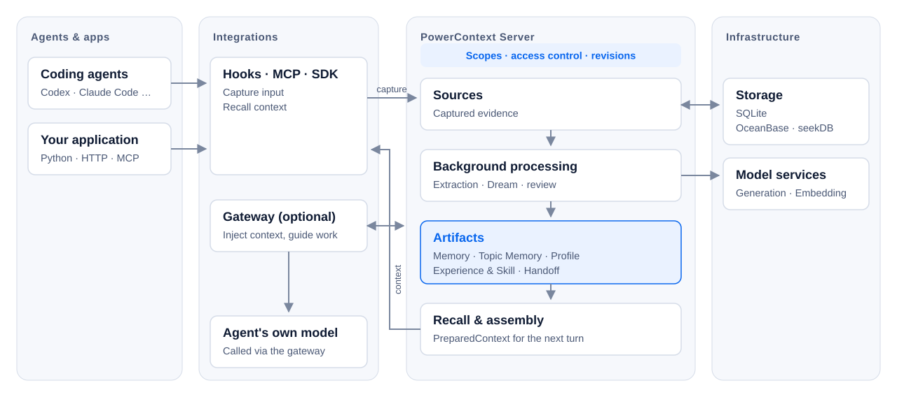

<p align="center">
  <picture>
    <source media="(prefers-color-scheme: dark)" srcset="docs/assets/readme-hero-en-dark.gif" />
    
  </picture>
</p>

<h3 align="center">AI Agent のためのオープンソース・コンテキストサービス</h3>
<p align="center">
  回り道を減らし、トークンを減らす。<br />
  <a href="#記憶と協働">パーソナルな記憶</a> · <a href="#記憶と協働">タスクの引き継ぎ</a> · <a href="#記憶と協働">Dream による自己進化</a> · <a href="#記憶と協働">複数 Agent での記憶共有</a> · <a href="#追跡と統制">Scope による分離</a>を、ひとつのサービスで。
</p>

<p align="center">
  <a href="#powercontext-とは">概要</a> &nbsp;·&nbsp;
  <a href="#なぜ-powercontext-なのか">特長</a> &nbsp;·&nbsp;
  <a href="#アーキテクチャ">アーキテクチャ</a> &nbsp;·&nbsp;
  <a href="#クイックスタート"><b>クイックスタート</b></a> &nbsp;·&nbsp;
  <a href="#エコシステム">エコシステム</a> &nbsp;·&nbsp;
  <a href="#最新情報">最新情報</a> &nbsp;·&nbsp;
  <a href="https://powercontext.oceanbase.io/en/docs/">ドキュメント</a> &nbsp;·&nbsp;
  <a href="https://discord.com/invite/74cF8vbNEs">Discord</a>
</p>
<p align="center">
  <a href="README.md">English</a> · <a href="README_CN.md">中文</a> · <a href="README_JP.md">日本語</a> &nbsp; / &nbsp;
  <a href="https://pypi.org/project/powercontext/">Python package</a> · <a href="LICENSE">Apache 2.0</a>
</p>

## PowerContext とは

**PowerContext は、Agent や Harness のコンテキスト管理を支えるサービスです。** 会話、資料、作業記録を、検索・更新でき、出典までたどれる知識に整理し、必要なときに Agent へ届けます。

- **トークンの節約：** 正しいコードを見つけ、必要な箇所だけを読むよう Agent を導き、タスク完了までの往復を減らします。[検証結果 →](#トークンの節約)
- **複数 Agent の協働：** 複数の Agent、セッション、チームメンバーが同じ Scope の記憶を共有し、引き継ぎで作業を続けます。[詳しく →](#記憶と協働)
- **自己進化：** Dream が過去の根拠から記憶とプロンプトの改訂を提案し、あなたのレビュー後に反映します。[詳しく →](#記憶と協働)
- **出典をたどれる：** すべての記憶は、根拠となる Source と正確なリビジョンまでたどれます。[詳しく →](#追跡と統制)
- **安全に管理：** Scope ごとにデータと権限を分離し、生成された経験とスキルはレビュー後にのみ想起されます。[詳しく →](#追跡と統制)

サービスとして起動して HTTP、MCP、Python、Agent 連携から使うことも、Core を自分のアプリケーションに組み込むこともできます。

<!-- 動画の位置：2 回目のセッションで Agent が 1 回目の作業を引き継ぐ様子を、30〜60 秒の実録で。 -->
<table width="100%">
  <tr>
    <td width="50%" valign="top"><br /><sub><b>記憶</b> · 判断と制約に出典とリビジョン</sub></td>
    <td width="50%" valign="top"><br /><sub><b>引き継ぎ</b> · 進捗、次のアクション、未対応の項目</sub></td>
  </tr>
</table>

## なぜ PowerContext なのか

### トークンの節約

**Agent はモデルを呼び出すたびに、積み上がったコンテキストを丸ごと送り直します。** そのため PowerContext は、タスク全体を終えるまでの往復回数と総コストを最適化します。正しいコードを見つけ、必要な箇所だけを読み、独立した操作をまとめ、関連するテストだけを実行するよう導き、探索のやり直しや無駄な試行を減らします。

- **同じ 24 タスク、記憶の生成を含む：** トークンは **32.57% 減少**、推定モデルコストは **15.42% 低下**し、両群は同じ 16 タスクを解決しました。問題解決のみではトークンが 40.30% 減少し、単一タスクでは最大 63.49% 減少しました。
- **往復の削減：** 同じタスク ID を使った別の実験（OFF と MS の比較）では、メインモデルへのリクエストが 708 回から 539 回へ、**23.87% 減少**しました。この実験は構成が異なるため、上の数値と合算はできません。
- **記憶の生成もキャッシュを再利用：** 記憶の生成にはトークンがかかり、上の 32.57% にも含まれています。ゲートウェイモードでは、問題解決リクエストのコンテキストのプレフィックスを再利用でき、キャッシュ項目が記録された記憶生成の呼び出しでは、入力の 97% がキャッシュにヒットしました。

このベンチマークは**ゲートウェイモード**で、コード検索、作業ガイダンス、プロジェクトの記憶を同時に有効にしています。


[24 タスクのベンチマーク：結果と集計方法 →](docs/benchmarks/token-savings/README.md) · [メインモデルのリクエスト数 →](docs/benchmarks/token-savings/request-counts_JP.md) · [記憶抽出のコストと品質 →](https://gist.github.com/jasper-yl/d02bfb7d9b45ca175bf74ad09cfa5ba4#file-00-report-en-md)

### 記憶と協働

複数の Agent、セッション、チームメンバーが同じ Scope の記憶を共有でき、一人ひとりが自分の記憶ルールを決められます。

<!-- Each card is editable HTML; keep text and links aligned across the three READMEs. -->
<table width="100%">
  <tr>
    <td colspan="2" width="1000" valign="top">
      
      <p><strong>一人ひとりに、自分だけの記憶ルール</strong></p>
      <h3>記憶のルールは、自分で</h3>
      <blockquote><p>「長く使う決定事項と制約だけを残し、一時的なやり取りは会話の中に。」</p></blockquote>
      <p>個人用 Scope のプロンプトで、覚える内容と整理の仕方を決められます。</p>
      <p><a href="https://powercontext.oceanbase.io/en/docs/workflows/manage-prompts/"><b>自分の記憶ルールを作る →</b></a></p>
    </td>
  </tr>
  <tr>
    <td width="50%" valign="top">
      
      <p><sub>Profile</sub></p>
      <h3>いつものやり方で</h3>
      <blockquote><p>「設計レビューは Yuque にまとめて。」</p></blockquote>
      <p>使うツール、書き方、仕事の進め方をプロフィールに残せます。</p>
      <p><a href="https://powercontext.oceanbase.io/en/docs/workflows/use-profiles/">プロフィールを見る →</a></p>
    </td>
    <td width="50%" valign="top">
      
      <p><sub>Topic Memory</sub></p>
      <h3>プロジェクトの経緯</h3>
      <p><code>日々の議論</code> → <code>テーマ別の要約</code> → <code>必要な詳細</code></p>
      <p>まず要約を読み、必要に応じて背景や根拠をたどれます。</p>
      <p><a href="https://powercontext.oceanbase.io/en/docs/workflows/topic-memory/">プロジェクトの知識を残す →</a></p>
    </td>
  </tr>
  <tr>
    <td width="50%" valign="top">
      
      <p><sub>Dream</sub></p>
      <h3>経験から見直す</h3>
      <p><code>過去の根拠</code> → <code>修正案</code> → <code>あなたが承認</code></p>
      <p>過去のやり取りをもとに記憶やプロンプトの修正を提案し、承認後に反映します。</p>
      <p><a href="https://powercontext.oceanbase.io/en/docs/workflows/review-dream-revisions/">Dream を見る →</a></p>
    </td>
    <td width="50%" valign="top">
      
      <p><sub>Handoff</sub></p>
      <h3>続きから再開</h3>
      <p><code>確認済みの進捗</code> → <code>次の手順</code> → <code>新しいセッション</code></p>
      <p>目標と進捗、次の手順を引き継ぎ、現状を確かめて再開できます。</p>
      <p><a href="https://powercontext.oceanbase.io/en/docs/workflows/memory-and-handoff/">作業を引き継ぐ →</a></p>
    </td>
  </tr>
</table>

### 追跡と統制

- **根拠のある記憶：** それぞれの記憶は、根拠となる Source と正確なリビジョンまでたどれ、Source 内の具体的な位置も示せます。
- **レビューを経た変更：** 生成された経験とスキルはレビュー後にのみ想起され、Dream の改訂はあなたの承認後に反映されます。古くなった記憶は履歴を残したまま無効化できます。
- **明確な境界：** Scope ごとにデータとアクセス権を分離します。運用テレメトリにはプロンプト、本文、モデルの応答は含まれません。

[候補のレビュー →](https://powercontext.oceanbase.io/en/docs/workflows/review-candidates/) · [Scope とアクセス制御 →](https://powercontext.oceanbase.io/en/docs/workflows/scopes-and-access/)

## アーキテクチャ

<picture>
  <source media="(prefers-color-scheme: dark)" srcset="docs/assets/readme-architecture-en-dark.svg" />
  
</picture>

Agent は Hooks、MCP、SDK で Server に接続します。モデルへのリクエストをゲートウェイ経由にすると、ゲートウェイがコンテキストを注入し、作業ガイダンスを提供します。Server は Scope ごとに根拠（Source）を保存し、バックグラウンドで記憶、Topic Memory、プロファイル、経験、スキルなどの Artifact に整理し、次のターンで使うコンテキストとして想起・組み立てます。[アーキテクチャと責任範囲 →](https://powercontext.oceanbase.io/en/docs/workflows/architecture/)

## クイックスタート

### Agent にインストールを任せる

次の文章をコピーして Agent に送ってください（例は Codex）。

```text
PowerContext をインストールして Codex に接続してください。PowerContext は AI Agent のためのオープンソースのコンテキストサービスです（https://github.com/oceanbase/powercontext）。以下のコマンドとリンクは公式ドキュメントのものです。

1. 公式のインストールスクリプトを実行してください。ネットワーク接続が必要で、私のホームディレクトリに書き込みます。サンドボックスで止められた場合は、先に私の許可を求めてください：
   curl -fsSL https://powercontext.oceanbase.io/install.sh | bash
2. クイックスタートを読み、設定、サービスの起動、Scope の作成と紐付け、Codex 連携のインストールまで案内してください：
   https://powercontext.oceanbase.io/en/llms.mdx/docs/get-started/quickstart/content.md
   設定ウィザードは対話式です。私の代わりに答えず、powercontext config init --output .env を私自身のターミナルで実行するよう伝えてください。モデルの認証情報などを選ぶ前には私に確認してください。
3. 最後に、Codex の /hooks で PowerContext のフックを信頼する方法と、記憶が機能しているか確かめる方法を教えてください。
```

<details>
<summary><b>自分でインストールする</b></summary>

Python 3.11+、Git、[uv](https://docs.astral.sh/uv/getting-started/installation/) と、接続する Agent の CLI が必要です。以下は macOS と Linux 向けにバージョン **1.5.2** をインストールする手順です。Windows のサポートは実験段階です。[インストールスクリプト](https://powercontext.oceanbase.io/en/docs/get-started/install-and-run/#install-with-the-recommended-script)を使えば、Python と uv も用意できます。

ウィザードは英語で表示されます。Server 用の追加のモデル API なしで明示的な保存と想起を試すには、**Basic memory** を選んでください。自動抽出には、Generation と Embedding の認証情報を設定した **Full memory** が必要です。最初のストレージには SQLite が手軽です。

```bash
uv tool install --force "powercontext[cli,server]==1.5.2"
mkdir -p powercontext-config && cd powercontext-config
powercontext config init --language en --output .env
powercontext config validate --env-file .env
powercontext service install --env-file .env
powercontext service status
```

サービスはターミナルを閉じた後も動作し続けます。Linux では `systemd --user` が利用できる必要があります。生成される `.env` と `.env.next-steps.md` には認証情報が含まれることがあるため、Git にコミットしないでください。

生成された環境ファイルを読み込み、サービスを確認します。

```bash
set -a
. ./.env
set +a
powercontext ready
powercontext capabilities
```

**`.env.next-steps.md`** に従って Scope を作成し、作成リクエストが返した実際の `scope_id` を使って紐付けます。Dashboard と Agent は同じ Server と Scope に接続してください。ディレクトリを変えるだけではプロジェクトは分離されません。`.env` を編集した場合は再度読み込み、`powercontext service install --env-file .env` を再実行して反映します。

Codex には対応するバージョンの連携をインストールします。

```bash
powercontext setup codex --env-file .env --ref powercontext-v1.5.2
powercontext doctor codex
```

新しい Codex セッションで最初のメッセージを送る前に、**`/hooks`** を開き、求められたら PowerContext Hook の信頼を許可してください。入力の自動取得と想起には `UserPromptSubmit` Hook の有効化が必要です。MCP に接続できるだけでは動作しません。[初回確認と復旧 →](https://powercontext.oceanbase.io/en/docs/integrations/codex/#first-session-hook-trust)

選んだワークフローを確認します。

- **Basic memory：** Agent にプロジェクトの判断を明示的に保存させ、同じ Scope の新しいセッションで、出典を参照しながら想起できることを確認します。
- **Full memory：** 入力が Source として保存され、設定した処理によって Topic Memory が生成されるのを待ちます。続いて関連する更新を送り、その内容が反映され、新しいセッションで想起できることを確認します。

`doctor codex` が確認するのはインストールと接続だけです。Source の取得だけでは記憶は作られず、自動処理には設定したスケジュールとモデルの実行も必要です。Basic memory でも Agent 自身のモデルは使用します。[完全なセットアップ手順 →](https://powercontext.oceanbase.io/en/docs/get-started/quickstart/)

<sub>この手順はコンテキストサービスを起動するものです。ベンチマークの Gateway、CodeGraph、Steering の設定は自動では再現されません。詳細は検証レポートを参照してください。</sub>

</details>

## エコシステム

<!-- Add integrations using an original logo asset, a product name, and a documentation link. -->
<table width="100%">
  <tr>
    <td align="center" width="20%"><a href="https://powercontext.oceanbase.io/en/docs/integrations/codex/"><br />Codex</a></td>
    <td align="center" width="20%"><a href="https://powercontext.oceanbase.io/en/docs/integrations/claude-code/"><br />Claude Code</a></td>
    <td align="center" width="20%"><a href="https://github.com/oceanbase/powercontext/tree/master/integrations/minimax#readme"><br />MiniMax Code</a></td>
    <td align="center" width="20%"><a href="https://powercontext.oceanbase.io/en/docs/integrations/dsh/"><br />DeepSeek Harness</a></td>
    <td align="center" width="20%"><a href="https://powercontext.oceanbase.io/en/docs/integrations/zcode/"><br />ZCode</a></td>
  </tr>
  <tr>
    <td align="center" width="20%"><a href="https://powercontext.oceanbase.io/en/docs/integrations/kimi-code/"><br />Kimi Code</a></td>
    <td align="center" width="20%"><a href="https://github.com/oceanbase/powercontext/tree/master/integrations/hermes#readme"><br />Hermes Agent</a></td>
    <td align="center" width="20%"><a href="https://powercontext.oceanbase.io/en/docs/integrations/pi/"><br />Pi Coding Agent</a></td>
    <td align="center" width="20%"><a href="https://powercontext.oceanbase.io/en/docs/integrations/openclaw/"><br />OpenClaw</a></td>
    <td align="center" width="20%"><a href="https://powercontext.oceanbase.io/en/docs/integrations/opencode/"><br />OpenCode</a></td>
  </tr>
  <tr>
    <td align="center" width="20%"><a href="https://github.com/oceanbase/powercontext/tree/master/integrations/workbuddy#readme"><br />WorkBuddy</a></td>
    <td align="center" width="20%"><a href="https://github.com/oceanbase/powercontext/tree/master/integrations/bub#readme"><br />Bub</a></td>
    <td align="center" width="20%"><a href="https://powercontext.oceanbase.io/en/docs/integrations/pydantic-ai/"><br />Pydantic AI</a></td>
    <td align="center" width="20%"><a href="https://powercontext.oceanbase.io/en/docs/integrations/langchain/"><br />LangChain</a></td>
    <td align="center" width="20%"><a href="https://powercontext.oceanbase.io/en/docs/integrations/langgraph/"><br />LangGraph</a></td>
  </tr>
</table>

Codex 連携は公式メンテナンス、その他の Agent と Python フレームワークの連携はコミュニティメンテナンスです。Bub は評価専用です。対応機能は機能一覧を参照してください。

[その他の連携と機能一覧 →](https://powercontext.oceanbase.io/en/docs/integrations/capabilities/)

**アプリケーションとチーム** — [Python / HTTP / MCP](https://powercontext.oceanbase.io/en/docs/develop/interfaces/) · [Memory と Handoff](https://powercontext.oceanbase.io/en/docs/workflows/memory-and-handoff/) · [デプロイとアクセス制御](https://powercontext.oceanbase.io/en/docs/workflows/scopes-and-access/)

## 最新情報

- **2026-11-16 · [v1.5.2](https://github.com/oceanbase/powercontext/releases/tag/powercontext-v1.5.2)** — 書き込みのバッチ化とクエリの最適化。メンテナーの計測では、v1.5.1 と比べて書き込みスループットが約 190%、クエリスループットが約 171% 向上しました。Dashboard で処理の進捗、失敗の診断、トークン使用量を確認できます。
- **2026-11-09 · [v1.5.1](https://github.com/oceanbase/powercontext/releases/tag/powercontext-v1.5.1)** — 記憶を Source 内の正確な位置までたどれるようになり、メトリクス、ログ、トレースを扱う監視スタックを任意で追加できます。
- **2026-11-03 · [v1.5.0](https://github.com/oceanbase/powercontext/releases/tag/powercontext-v1.5.0)** — Source と Artifact のプラグインで、データの取り込みと独自の Artifact を拡張できます。可逆なエンコードで、モデル入力に含まれる重複した根拠を減らします。

[すべてのリリース →](https://github.com/oceanbase/powercontext/releases)

## さらに詳しく

- [基本概念](https://powercontext.oceanbase.io/en/docs/get-started/core-concepts/) · [アーキテクチャと責任範囲](https://powercontext.oceanbase.io/en/docs/workflows/architecture/) · [プラグイン](https://powercontext.oceanbase.io/en/docs/develop/plugins/)
- [Python / HTTP / MCP インターフェース](https://powercontext.oceanbase.io/en/docs/develop/interfaces/) · [Server のデプロイ](https://powercontext.oceanbase.io/en/docs/operate/deploy-server/)
- [トークン削減のベンチマーク](docs/benchmarks/token-savings/README.md) · [ブログ](https://powercontext.oceanbase.io/en/blog/)

## コミュニティ

[Discord](https://discord.com/invite/74cF8vbNEs) · [Issues](https://github.com/oceanbase/powercontext/issues) · [コントリビューション](https://github.com/oceanbase/powercontext/blob/master/CONTRIBUTING.md)

PowerContext は [PowerMem](https://www.powermem.ai/) の後継プロジェクトであり、[Apache 2.0](LICENSE) ライセンスで公開されています。
